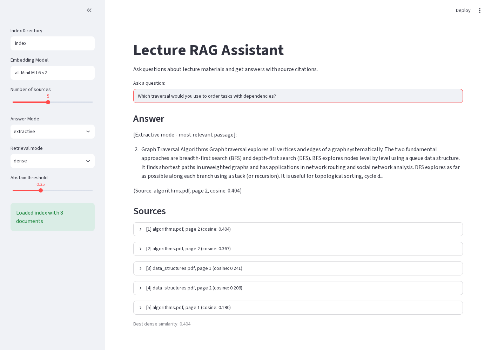
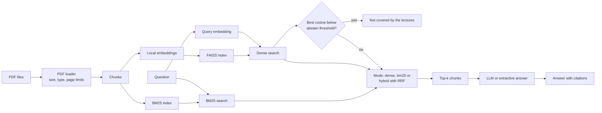

# Lecture RAG Assistant

A Retrieval-Augmented Generation (RAG) system for university lecture materials. Ask questions about your lecture PDFs and get answers with page-level source citations, or an explicit "not covered" when the material does not answer the question.



*The local demo in its default dense mode answering "How does DBSCAN identify core points and outliers?" from the `data/corpus` index, with page-level sources and cosine scores.*

**Live demo:** not deployed yet. A link will be added here once the hosted demo is available.

## Local Quickstart

On a machine without a GPU, first run `pip install torch --index-url https://download.pytorch.org/whl/cpu` to get the smaller CPU-only PyTorch build, then continue with `pip install -e .`.

```bash
pip install -e .
lecture-rag ingest data/corpus --index-dir index-corpus
lecture-rag ask "How does DBSCAN identify core points and outliers?" --index-dir index-corpus
```

The first `ingest` downloads the `all-MiniLM-L6-v2` embedding model. No API key is needed: answers are extractive unless you configure an LLM (see [Configuration](#configuration)).

## Why This Project?

As a Computer Science student at KIT Karlsruhe, I often need to search through large collections of lecture materials to find specific information. This tool demonstrates practical application of modern NLP techniques while solving a real student workflow problem.

Key features:
- **Fully local embeddings** using sentence-transformers (no API key needed for indexing)
- **Flexible LLM backend** supporting OpenAI, DeepSeek, Ollama, or any OpenAI-compatible API
- **Extractive fallback mode** for completely offline operation
- **Page-level citations** with file names and page numbers
- **Dense, BM25 and hybrid retrieval** combined with Reciprocal Rank Fusion
- **Abstention** when no indexed chunk is similar enough to the question
- **Evaluation harness** with committed results in `eval/results.md` (sample lectures) and `eval/corpus/results.md` (the real corpus)

## Architecture



**Components:**
- **PDF Loader**: Extracts text with page-level metadata using PyMuPDF
- **Chunking**: Splits documents with overlap to preserve context
- **Embeddings**: Local sentence-transformers model (all-MiniLM-L6-v2, 384 dimensions)
- **Vector Index**: FAISS flat index with inner product similarity
- **BM25 Index**: Lexical index over the same chunks (rank-bm25 Okapi), built when first needed
- **Retrieval**: Dense, BM25 or hybrid (Reciprocal Rank Fusion of both). The query is embedded once per search
- **Abstention**: Declines to answer when the best dense cosine similarity is below the threshold
- **Generation**: Provider abstraction supporting LLM or extractive modes

### Retrieval Modes

- **dense**: FAISS cosine similarity search over sentence-transformer embeddings.
- **bm25**: Sparse lexical search using the rank-bm25 Okapi implementation.
- **hybrid**: Reciprocal Rank Fusion of dense and bm25 results. Each document's score is the sum of `1 / (60 + rank)` across both ranked lists, and the top `max(4k, 20)` candidates are taken from each retriever before fusion.

## Setup and Usage

### Installation

```bash
git clone https://github.com/arda6111/lecture-rag-assistant.git
cd lecture-rag-assistant
python -m venv venv
source venv/bin/activate  # On Windows: venv\Scripts\activate
pip install -e .
```

### Basic Usage

The repository ships two data sets:

- `data/sample_lectures/` holds 4 generated pages, used by the tests and the eval in this README. (`scripts/generate_sample_pdfs.py` only recreates them.)
- `data/corpus/` holds six CC BY 4.0 tutorials and lecture notes from arXiv on transformers, autoencoders, reinforcement learning, testing neural networks, MLOps and clustering. Sources, licenses and checksums are in `data/SOURCES.md`.

1. **Index lecture PDFs**:

```bash
lecture-rag ingest data/sample_lectures
```

This creates a local index in the `index/` directory.

For the larger corpus, use a separate index directory:

```bash
lecture-rag ingest data/corpus --index-dir index-corpus
```

This gives 861 chunks from 163 pages with the default chunk size of 512 and overlap of 64 (the count depends only on the chunking, not on the embedding model). The same count is recorded as `indexed_chunks` in `eval/corpus/results.json`, and a test checks both against the corpus.

Put your own lecture PDFs in `data/local/`, which is ignored by git, so course material you are not allowed to share never gets committed.

`ingest` writes `index_meta.json` with the embedding model name and vector dimension; indexes from older versions without it still load and are only checked by dimension; querying with a different model is an error and needs a re-ingest with that model, unless you pass `--allow-model-mismatch`.

2. **Ask questions**:

```bash
lecture-rag ask "What is dynamic programming?" --mode extractive
```

3. **Run evaluation**:

```bash
lecture-rag eval
```

## Configuration

Copy `.env.example` to `.env` and configure it. The CLI and the demo load `.env` automatically. The API settings are only needed for LLM mode:

```bash
cp .env.example .env
```

Edit `.env`:

```env
OPENAI_API_KEY=sk-...
OPENAI_BASE_URL=https://api.openai.com/v1
OPENAI_MODEL=gpt-3.5-turbo
```

**Supported backends:**
- OpenAI (gpt-3.5-turbo, gpt-4)
- DeepSeek (base URL: https://api.deepseek.com/v1)
- Local Ollama (base URL: http://localhost:11434/v1)
- Any OpenAI-compatible API

LLM mode needs `OPENAI_API_KEY`, unless `OPENAI_BASE_URL` points at a local server on localhost or 127.0.0.1 such as Ollama. Without either, `--mode llm` stops with an error before making any request.

**Extractive mode works offline without any API configuration** (the embedding model is downloaded once on first use).

## CLI Usage

### Ingest Command

```bash
lecture-rag ingest <directory> [OPTIONS]
```

Options:
- `--index-dir PATH`: Output directory for index (default: `index`)
- `--model NAME`: Sentence-transformers model (default: `all-MiniLM-L6-v2`)
- `--chunk-size INT`: Max characters per chunk, at least 1 (default: 512)
- `--chunk-overlap INT`: Overlap between chunks, at least 0 and smaller than the chunk size (default: 64)
- `--max-file-size-mb FLOAT`: Maximum PDF file size in MB (default: `LECTURE_RAG_MAX_FILE_SIZE_MB` or `50`)
- `--max-pages INT`: Maximum number of PDF pages (default: `LECTURE_RAG_MAX_PAGES` or `500`)

`.pdf` files are matched case-insensitively. The command exits with an error if no PDF could be loaded.

### Ask Command

```bash
lecture-rag ask "your question" [OPTIONS]
```

Options:
- `--index-dir PATH`: Index directory (default: `index`)
- `--model NAME`: Embedding model, must match ingest model
- `--allow-model-mismatch`: Continue with a warning when `--model` differs from the model the index was built with
- `--k INT`: Number of sources to retrieve, at least 1 (default: 5)
- `--mode {llm|extractive}`: Answer generation mode (default: `extractive`)
- `--retrieval {dense|bm25|hybrid}`: Retrieval mode (default: `LECTURE_RAG_RETRIEVAL_MODE` or `dense`)
- `--abstain-threshold FLOAT`: Minimum dense similarity required to answer, between 0 and 1 (default: `LECTURE_RAG_ABSTAIN_THRESHOLD` or `0.35`)
- `--rerank`: Rerank candidates with a cross-encoder (off by default)
- `--rerank-candidates INT`: Candidates retrieved before reranking, at least 1 (default: `max(4*k, 20)`)
- `--rerank-model NAME`: Cross-encoder model (default: `LECTURE_RAG_RERANK_MODEL` or `cross-encoder/ms-marco-MiniLM-L-6-v2`)

### Abstention

When the best dense cosine similarity between the question and any indexed chunk falls below the abstain threshold, the system declines to answer instead of producing an answer without support:

```bash
lecture-rag ask "What is the capital of France?"
# The lecture materials do not seem to cover this question.
```

The signal always uses dense similarity because BM25 and RRF scores are on different scales and are not comparable to a fixed cosine threshold. Source scores are printed with their kind, for example `cosine: 0.612`, `bm25: 3.210` or `rrf: 0.033`; an RRF score is a rank-fusion score, not a similarity.

### Reranking

Cross-encoder reranking is optional and off by default. Add `--rerank` to `ask` or `eval` to retrieve a larger candidate pool with the selected first-stage mode and reorder it with a cross-encoder. The cross-encoder is downloaded on first use only when `--rerank` is given; without it, no cross-encoder is loaded.

The candidate pool is `--rerank-candidates` when set, otherwise `max(4*k, 20)`, and it is never smaller than `k`. The default model is `cross-encoder/ms-marco-MiniLM-L-6-v2`; set `LECTURE_RAG_RERANK_MODEL` or pass `--rerank-model` to use another model. Passing `--rerank-candidates` or `--rerank-model` without `--rerank` is an error.

Abstention always uses the first-stage dense cosine similarity, also when reranking. Cross-encoder scores are unbounded logits on a different scale and are never compared with `--abstain-threshold`, so the same threshold applies with and without reranking.

### Eval Command

```bash
lecture-rag eval [OPTIONS]
```

Options:
- `--eval-file PATH`: Evaluation JSON file (default: `eval/eval_set.json`)
- `--index-dir PATH`: Index directory (default: `index`)
- `--model NAME`: Embedding model
- `--allow-model-mismatch`: Continue with a warning when `--model` differs from the model the index was built with
- `--k INT`: Number of documents for metrics, at least 1 (default: 5)
- `--retrieval {dense|bm25|hybrid}`: Retrieval mode (default: `LECTURE_RAG_RETRIEVAL_MODE` or `dense`)
- `--compare`: Evaluate and compare dense, bm25, and hybrid retrieval
- `--sweep`: Sweep abstain thresholds from 0.20 to 0.60 in dense mode
- `--output DIR`: Evaluate all modes at k and at 1, run the sweep, and write `DIR/results.json` and `DIR/results.md`
- `--abstain-threshold FLOAT`: Minimum dense similarity required to answer, between 0 and 1 (default: `LECTURE_RAG_ABSTAIN_THRESHOLD` or `0.35`)
- `--rerank`: Rerank candidates with a cross-encoder (off by default)
- `--rerank-candidates INT`: Candidates retrieved before reranking, at least 1 (default: `max(4*k, 20)`)
- `--rerank-model NAME`: Cross-encoder model (default: `LECTURE_RAG_RERANK_MODEL` or `cross-encoder/ms-marco-MiniLM-L-6-v2`)

Set the `LECTURE_RAG_RETRIEVAL_MODE` environment variable to choose the default retrieval mode for `ask` and `eval`. The `--retrieval` option overrides the environment variable.

Set the `LECTURE_RAG_ABSTAIN_THRESHOLD` environment variable to choose the default abstain threshold for `ask` and `eval` (default: `0.35`). The `--abstain-threshold` option overrides the environment variable. A value outside 0 to 1, or a value that is not a number, logs a warning and falls back to `0.35`; valid values are rounded to the nearest `0.05`.

## Web Demo

Launch the interactive Streamlit demo:

```bash
pip install -e ".[demo]"
streamlit run demo.py
```

Navigate to http://localhost:8501 in your browser.

The sidebar controls the retrieval mode (dense, bm25, or hybrid), the abstain threshold, the number of sources to retrieve, the answer mode (extractive or llm), and an optional cross-encoder rerank toggle (off by default; the model is loaded only when it is switched on). It also lets you set the index directory; the `LECTURE_RAG_INDEX_DIR` environment variable sets its default value (falling back to `index`).

### Public demo on Streamlit Community Cloud

The public demo runs in corpus mode on the committed PDFs in `data/corpus`. Corpus mode is selected automatically when `LECTURE_RAG_INDEX_DIR` is unset and `index/index.faiss` does not exist, which is the case on Streamlit Community Cloud. Set `LECTURE_RAG_DEMO_MODE=corpus` or `LECTURE_RAG_DEMO_MODE=local` to select a mode explicitly. The index is built on first start into a temporary directory under the system temp path, then reused by later sessions.

The demo limits each question to 500 characters, retrieves at most 10 sources, and allows at most 30 searches per browser session (changing a sidebar setting reruns the search and counts as one). Reranking is off by default and can be disabled for a deployment with `LECTURE_RAG_DEMO_DISABLE_RERANK=1` (also accepts `true` or `yes`). An OpenAI API key is optional. When entered, it is held only in that session's Streamlit session state (not cached, logged or written to disk), and it is sent only to `https://api.openai.com/v1`; without a key the demo uses extractive answers.

To regenerate the screenshot in this README:

```bash
streamlit run demo.py --server.headless true
```

Then, in a second terminal:

```bash
pip install -e ".[demo,screenshot]"
playwright install chromium
python scripts/capture_demo_screenshot.py
```

This writes `docs/demo.png`. The screenshot above was taken against an index of `data/corpus`: start the demo with `LECTURE_RAG_INDEX_DIR=index-corpus` and pass `--question "How does DBSCAN identify core points and outliers?"` to the script.

## Evaluation Results

The numbers below come from `eval/results.md` and `eval/results.json`, which are committed and produced by:

```bash
lecture-rag ingest data/sample_lectures
lecture-rag eval --output eval
```

**Eval set:** 33 questions in `eval/eval_set.json` (25 answerable spread over all 4 pages, many paraphrased; 8 unanswerable off-topic questions). Hit@k and MRR are computed over the 25 answerable questions; abstain accuracy over all 33. The index has 8 chunks.

**Retrieval mode comparison (abstain threshold 0.35)**

| Mode | Hit@5 | MRR@5 | Hit@1 | MRR@1 | Abstain acc |
|------|-------|-------|-------|-------|-------------|
| dense | 1.000 | 1.000 | 1.000 | 1.000 | 0.939 |
| bm25 | 1.000 | 0.980 | 0.960 | 0.960 | 0.939 |
| hybrid | 1.000 | 1.000 | 1.000 | 1.000 | 0.939 |

**Abstention at threshold 0.35 (dense)**

| Metric | Value |
|--------|-------|
| Abstain accuracy | 0.939 |
| Abstain precision | 0.800 |
| Abstain recall | 1.000 |
| Hit@5 after abstain | 0.920 |
| Mean cosine score (top 5) | 0.295 |

**Threshold sweep (dense)**

| Threshold | Abstain acc |
|-----------|-------------|
| 0.20 | 0.939 |
| 0.25 | 0.909 |
| 0.30 | 0.939 |
| 0.35 | 0.939 |
| 0.40 | 0.939 |
| 0.45 | 0.879 |
| 0.50 | 0.818 |
| 0.55 | 0.727 |
| 0.60 | 0.576 |

**What this shows, and what it does not:**
- All 8 off-topic questions are rejected at 0.35 (their best similarity is 0.11 to 0.29). 2 answerable paraphrased questions (strongly connected components, memoization vs bottom-up) score 0.23 and 0.26 and are wrongly rejected.
- 0.35 is the midpoint of the 0.30 to 0.40 plateau of the sweep.
- The sample corpus has only 4 pages, so dense and hybrid retrieval are saturated and BM25 misses one question at rank 1. These numbers are a sanity check, not a benchmark. A larger corpus is needed to compare the modes meaningfully.

### Real corpus (data/corpus)

The block below is generated from `eval/corpus/results.json` by `scripts/run_corpus_eval.py`, and a test checks that it matches the committed results, so none of its numbers are typed by hand.

**Eval set:** `eval/corpus/eval_set.json` has answerable questions over all six PDFs and a set of unanswerable ones. Each answerable question names its expected file and one or more expected pages (`expected_pages`), and was written by reading those pages. A retrieved chunk counts as a hit when it comes from the expected file and one of the expected pages. Most unanswerable questions are off-topic; two are near-domain (support vector machines and quicksort) and are not covered by the corpus. Hit@k and MRR are computed over the answerable questions, abstain metrics over all questions.

Some labels list several pages because the answer is spread over them in the PDF. For example, the Tay question is discussed on pages 7 and 8 and again on pages 19 and 20 of the MLOps primer, weighted kernel k-means is defined across pages 10, 11 and 13 of the clustering notes, and canary deployment starts on page 17 and continues on page 18. Only one label was changed after seeing results: the temporal-difference question had been widened to pages 14 and 15 and was reverted to page 15, where the definition (eq. 33) is.

**Reproduce:**

```bash
pip install -e ".[dev]"
python scripts/run_corpus_eval.py                # downloads all-MiniLM-L6-v2 on the first run
python scripts/run_corpus_eval.py --render-only  # rebuild results.md and this block from results.json
```

The script builds in-memory indexes of `data/corpus` at chunk sizes 256, 512 and 1024 (overlap 64), evaluates all three retrieval modes at chunk size 512, and writes `eval/corpus/results.json`, `eval/corpus/results.md` and the block below. It does not write an index directory. CI does not run it and never downloads the model; the tests run the same code offline with the hashing test model and compare the committed results with this README.

<!-- corpus-eval:start -->

The corpus in `data/corpus` contains 6 PDFs with 163 loaded pages, indexed as 861 chunks at chunk size 512 with `all-MiniLM-L6-v2`, and evaluated on 58 questions (48 answerable, 10 unanswerable) at k=5 with an abstain threshold of 0.35.

#### Retrieval mode comparison

| Mode | Rerank | Hit@5 | MRR@5 | Hit@1 | MRR@1 |
|------|--------|-------|-------|-------|-------|
| dense | no | 0.917 | 0.754 | 0.625 | 0.625 |
| dense | yes | 0.958 | 0.878 | 0.812 | 0.812 |
| bm25 | no | 0.958 | 0.837 | 0.750 | 0.750 |
| bm25 | yes | 0.958 | 0.878 | 0.812 | 0.812 |
| hybrid | no | 0.938 | 0.819 | 0.729 | 0.729 |
| hybrid | yes | 0.958 | 0.878 | 0.812 | 0.812 |

Abstention uses the first-stage dense similarity and is therefore the same with and without rerank.

#### Abstention at threshold 0.35 (dense)

| Metric | Value |
|--------|-------|
| Abstain accuracy | 0.966 |
| Abstain precision | 1.000 |
| Abstain recall | 0.800 |
| Hit@5 after abstain | 0.917 |

#### Threshold sweep (dense)

| Threshold | Abstain acc |
|-----------|-------------|
| 0.20 | 0.931 |
| 0.25 | 0.948 |
| 0.30 | 0.948 |
| 0.35 | 0.966 |
| 0.40 | 0.966 |
| 0.45 | 0.983 |
| 0.50 | 1.000 |
| 0.55 | 0.948 |
| 0.60 | 0.914 |

#### Chunk size comparison

| Chunk size | Chunks | Hit@5 | MRR@5 | Abstain acc |
|------------|--------|-------|-------|-------------|
| 256 | 1895 | 0.917 | 0.774 | 0.948 |
| 512 | 861 | 0.917 | 0.754 | 0.966 |
| 1024 | 450 | 0.896 | 0.727 | 0.966 |

<!-- corpus-eval:end -->

**What this shows, and what it does not:**
- Without reranking, BM25 and hybrid retrieval rank the expected page higher than dense retrieval on this set. Many questions reuse terms from the text (tool and algorithm names such as DeepConcolic, EKiML or Q-learning), which favours keyword matching.
- Reranking the top 20 candidates with `cross-encoder/ms-marco-MiniLM-L-6-v2` improves MRR@5 and Hit@1 in every mode and does not lower Hit@5. Hit@1 goes from 30 to 39 of the 48 answerable questions for dense, from 36 to 39 for BM25 (the best mode without reranking, so +3) and from 35 to 39 for hybrid. Abstention does not change because it uses the first-stage dense similarity.
- After reranking, the three modes have the same page-level scores. The 20 candidates differ between modes, but 46 of the 48 answerable questions have their first hit at the same rank in all three modes, and the 2 that differ cancel out (the datasets question is at rank 1 with dense and rank 2 with BM25 and hybrid, the TestRNN question the other way round).
- Reranking costs about 0.1 s per query. Measured on the author's machine on 2026-10-29 (8-core Intel Xeon CPU, no GPU): about 3 to 5 ms per query without reranking and 87 to 107 ms with it. Latency is not part of the committed results; `scripts/run_corpus_eval.py` prints it and writes it to the git-ignored `eval/corpus/latency.local.json`. Because the gain is a few questions on a small set, `--rerank` stays an optional, off-by-default setting.
- The abstain threshold of 0.35 is the default chosen on the sample lectures and was not tuned on these questions. The sweep is shown for information only; picking its best value would fit the threshold to the same questions it is measured on.
- The two near-domain questions score above the threshold and are answered instead of rejected, which is why abstain recall is below 1. A single dense similarity cannot tell a related topic from one the lectures actually cover.
- Limitations: a small corpus of six documents; questions written by us after reading the pages, so they often share wording with the text and are easier than real student questions; page-level labels, some of which list several pages; one embedding model, one cross-encoder and one run.

## Testing

Run the test suite:

```bash
pip install -e ".[dev]"
pytest
```

CI also runs `ruff check src tests demo.py scripts`, `ruff format --check src tests demo.py scripts` and `mypy src demo.py scripts`.

The tests cover PDF loading and ingest limits, chunking, the FAISS and BM25 indexes, the three retrieval modes and RRF, abstention and eval metrics, answer generation, and the CLI (including an ingest and ask run on the sample PDFs and input validation errors).

The tests use a small deterministic hashing embedding model instead of sentence-transformers, so they run offline without API keys. They check behavior on the bundled sample data and do not measure retrieval quality on real lecture material.

## Project Structure

```
lecture-rag-assistant/
├── src/lecture_rag/       # Main package
│   ├── pdf_loader.py      # PDF extraction with metadata
│   ├── chunking.py        # Text splitting
│   ├── embeddings.py      # Local embedding model
│   ├── index.py           # FAISS vector index
│   ├── retrieval.py       # Search logic
│   ├── generation.py      # Answer generation (LLM + extractive)
│   ├── eval.py            # Evaluation harness
│   ├── models.py          # Pydantic data models
│   └── cli.py             # Command-line interface
├── tests/                 # Pytest test suite
├── data/sample_lectures/  # Sample PDFs
├── data/corpus/           # CC BY 4.0 lecture-style PDFs
├── data/SOURCES.md        # Sources, licenses and checksums for the corpus
├── docs/                  # README screenshot (demo.png)
├── eval/                  # Evaluation questions and committed results
├── scripts/               # Utility scripts
├── SECURITY.md            # Security policy and vulnerability reporting
├── .github/
│   └── dependabot.yml     # Dependency update configuration
└── demo.py                # Streamlit web demo
```

## Limitations and Roadmap

**Current limitations:**
- No cross-page context (chunks are bounded by pages)
- No re-ranking step after retrieval
- Simple chunking (fixed size, no semantic splitting)
- Single index (no multi-collection support)
- The eval sets are small and written by us: 33 questions over the 4 sample pages, and a few dozen questions over the 6 corpus PDFs

**Done:**
- [x] Hybrid search (dense + BM25 with Reciprocal Rank Fusion)
- [x] Abstention for questions the lectures do not cover
- [x] Committed, reproducible eval results

**Planned improvements:**
- [ ] Add re-ranking with a cross-encoder
- [ ] Evaluate on real lecture slides with questions written by students
- [ ] Support semantic chunking based on document structure
- [ ] Add conversation memory for follow-up questions
- [ ] Build a web API with FastAPI
- [ ] Add support for more document formats (PPTX, DOCX)

## Security

The ingest command only accepts real PDFs, verified by the `%PDF-` magic bytes. It rejects symlinks, encrypted PDFs (including PDFs with only an owner password), files over the size limit, and PDFs over the page limit.

The index stores chunk metadata as `documents.json` instead of pickle. Indexes built with older versions must be rebuilt with `lecture-rag ingest`.

Only load indexes you built yourself. `index.faiss` is a native binary format parsed by FAISS, and a crafted file can be unsafe. The loader rejects symlinks and invalid files, but it cannot make untrusted FAISS files safe.

CI runs `bandit`, `pip-audit` and `gitleaks` (a scan of the full git history). Dependabot is enabled. See [SECURITY.md](SECURITY.md) for reporting vulnerabilities.

## License

MIT License. See [LICENSE](LICENSE) for details.

The PDFs in `data/corpus/` are not covered by the MIT license: they are licensed under CC BY 4.0 by their original authors. See [data/SOURCES.md](data/SOURCES.md) for titles, authors, sources and licenses.

## Contributing

This is a portfolio project, but suggestions and feedback are welcome. Open an issue or submit a pull request.
