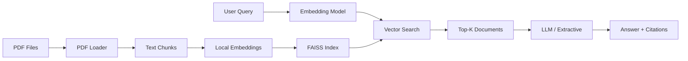

# Lecture RAG Assistant

A Retrieval-Augmented Generation (RAG) system for university lecture materials. Ask questions about your lecture PDFs and get accurate answers with source citations.

## Why This Project?

As a Computer Science student at KIT Karlsruhe, I often need to search through large collections of lecture materials to find specific information. This tool demonstrates practical application of modern NLP techniques while solving a real student workflow problem.

Key features:
- **Fully local embeddings** using sentence-transformers (no API key needed for indexing)
- **Flexible LLM backend** supporting OpenAI, DeepSeek, Ollama, or any OpenAI-compatible API
- **Extractive fallback mode** for completely offline operation
- **Precise citations** with file names and page numbers
- **Evaluation harness** for measuring retrieval quality

## Architecture



**Components:**
- **PDF Loader**: Extracts text with page-level metadata using PyMuPDF
- **Chunking**: Splits documents with overlap to preserve context
- **Embeddings**: Local sentence-transformers model (all-MiniLM-L6-v2, 384 dimensions)
- **Vector Index**: FAISS flat index with inner product similarity
- **Retrieval**: Cosine similarity search returning top-k chunks
- **Generation**: Provider abstraction supporting LLM or extractive modes

### Retrieval Modes

- **dense**: FAISS cosine similarity search over sentence-transformer embeddings.
- **bm25**: Sparse lexical search using the rank-bm25 Okapi implementation.
- **hybrid**: Reciprocal Rank Fusion of dense and bm25 results. Each document's score is the sum of `1 / (60 + rank)` across both ranked lists, and the top `max(4k, 20)` candidates are taken from each retriever before fusion.

## Quick Start

### Installation

```bash
git clone https://github.com/arda6111/lecture-rag-assistant.git
cd lecture-rag-assistant
python -m venv venv
source venv/bin/activate  # On Windows: venv\Scripts\activate
pip install -e .
```

### Basic Usage

1. **Generate sample data** (first time only):

```bash
python scripts/generate_sample_pdfs.py
```

2. **Index lecture PDFs**:

```bash
lecture-rag ingest data/sample_lectures
```

This creates a local index in the `index/` directory.

3. **Ask questions**:

```bash
lecture-rag ask "What is dynamic programming?" --mode extractive
```

4. **Run evaluation**:

```bash
lecture-rag eval
```

## Configuration

Copy `.env.example` to `.env` and configure (optional, only needed for LLM mode):

```bash
cp .env.example .env
```

Edit `.env`:

```env
OPENAI_API_KEY=sk-...
OPENAI_BASE_URL=https://api.openai.com/v1
OPENAI_MODEL=gpt-3.5-turbo
```

**Supported backends:**
- OpenAI (gpt-3.5-turbo, gpt-4)
- DeepSeek (base URL: https://api.deepseek.com/v1)
- Local Ollama (base URL: http://localhost:11434/v1)
- Any OpenAI-compatible API

**Extractive mode works completely offline without any API configuration.**

## CLI Usage

### Ingest Command

```bash
lecture-rag ingest <directory> [OPTIONS]
```

Options:
- `--index-dir PATH`: Output directory for index (default: `index`)
- `--model NAME`: Sentence-transformers model (default: `all-MiniLM-L6-v2`)
- `--chunk-size INT`: Max characters per chunk (default: 512)
- `--chunk-overlap INT`: Overlap between chunks (default: 64)

### Ask Command

```bash
lecture-rag ask "your question" [OPTIONS]
```

Options:
- `--index-dir PATH`: Index directory (default: `index`)
- `--model NAME`: Embedding model, must match ingest model
- `--k INT`: Number of sources to retrieve (default: 5)
- `--mode {llm|extractive}`: Answer generation mode (default: `extractive`)
- `--retrieval {dense|bm25|hybrid}`: Retrieval mode (default: `LECTURE_RAG_RETRIEVAL_MODE` or `dense`)

### Eval Command

```bash
lecture-rag eval [OPTIONS]
```

Options:
- `--eval-file PATH`: Evaluation JSON file (default: `eval/eval_set.json`)
- `--index-dir PATH`: Index directory (default: `index`)
- `--model NAME`: Embedding model
- `--k INT`: Number of documents for metrics (default: 5)
- `--retrieval {dense|bm25|hybrid}`: Retrieval mode (default: `LECTURE_RAG_RETRIEVAL_MODE` or `dense`)
- `--compare`: Evaluate and compare dense, bm25, and hybrid retrieval

Set the `LECTURE_RAG_RETRIEVAL_MODE` environment variable to choose the default retrieval mode for `ask` and `eval`. The `--retrieval` option overrides the environment variable.

## Web Demo

Launch the interactive Streamlit demo:

```bash
pip install -e ".[demo]"
streamlit run demo.py
```

Navigate to http://localhost:8501 in your browser.

## Evaluation Results

Results on the included sample dataset (6 questions over 2 lecture PDFs):

| Metric | Value |
|--------|-------|
| Total Questions | 6 |
| Hit@5 | 1.000 |
| MRR@5 | 1.000 |
| Mean Score | 0.379 |

**Retrieval mode comparison (6 questions, k=5 and k=1, measured with lecture-rag eval --compare)**

| Mode | Hit@5 | MRR@5 | Hit@1 | MRR@1 |
|------|-------|-------|-------|-------|
| dense | 1.000 | 1.000 | 1.000 | 1.000 |
| bm25 | 1.000 | 1.000 | 1.000 | 1.000 |
| hybrid | 1.000 | 1.000 | 1.000 | 1.000 |

The 6-question set is too easy to separate the modes; a larger set that includes unanswerable questions is planned.

**Interpretation:**
- **Hit@5 = 1.000**: All questions found the correct source in top 5 results
- **MRR@5 = 1.000**: Correct sources ranked first on average
- **Mean Score = 0.379**: Average cosine similarity across all top-5 results

These results demonstrate that the embedding model effectively captures semantic similarity for technical CS content.

## Testing

Run the test suite:

```bash
pip install -e ".[dev]"
pytest
```

Tests cover:
- PDF loading with page metadata
- Text chunking with overlap
- Vector index operations
- Citation metadata preservation
- Extractive fallback mode
- CLI command interfaces

All tests run offline without API keys or network access.

## Project Structure

```
lecture-rag-assistant/
├── src/lecture_rag/       # Main package
│   ├── pdf_loader.py      # PDF extraction with metadata
│   ├── chunking.py        # Text splitting
│   ├── embeddings.py      # Local embedding model
│   ├── index.py           # FAISS vector index
│   ├── retrieval.py       # Search logic
│   ├── generation.py      # Answer generation (LLM + extractive)
│   ├── eval.py            # Evaluation harness
│   ├── models.py          # Pydantic data models
│   └── cli.py             # Command-line interface
├── tests/                 # Pytest test suite
├── data/sample_lectures/  # Sample PDFs
├── eval/                  # Evaluation questions
├── scripts/               # Utility scripts
└── demo.py                # Streamlit web demo
```

## Limitations and Roadmap

**Current limitations:**
- No cross-page context (chunks are bounded by pages)
- Flat retrieval (no re-ranking or hybrid search)
- Simple chunking (fixed size, no semantic splitting)
- Single index (no multi-collection support)

**Planned improvements:**
- [ ] Add re-ranking with cross-encoder
- [ ] Implement hybrid search (dense + sparse)
- [ ] Support semantic chunking based on document structure
- [ ] Add conversation memory for follow-up questions
- [ ] Build web API with FastAPI
- [ ] Add support for more document formats (PPTX, DOCX)

## License

MIT License. See [LICENSE](LICENSE) for details.

## Contributing

This is a portfolio project, but suggestions and feedback are welcome! Open an issue or submit a pull request.
