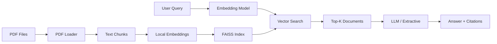

# Lecture RAG Assistant

A Retrieval-Augmented Generation (RAG) system for university lecture materials. Ask questions about your lecture PDFs and get accurate answers with source citations.

## Why This Project?

As a Computer Science student at KIT Karlsruhe, I often need to search through large collections of lecture materials to find specific information. This tool demonstrates practical application of modern NLP techniques while solving a real student workflow problem.

Key features:
- **Fully local embeddings** using sentence-transformers (no API key needed for indexing)
- **Flexible LLM backend** supporting OpenAI, DeepSeek, Ollama, or any OpenAI-compatible API
- **Extractive fallback mode** for completely offline operation
- **Precise citations** with file names and page numbers
- **Evaluation harness** for measuring retrieval quality

## Architecture



**Components:**
- **PDF Loader**: Extracts text with page-level metadata using PyMuPDF
- **Chunking**: Splits documents with overlap to preserve context
- **Embeddings**: Local sentence-transformers model (all-MiniLM-L6-v2, 384 dimensions)
- **Vector Index**: FAISS flat index with inner product similarity
- **Retrieval**: Cosine similarity search returning top-k chunks
- **Generation**: Provider abstraction supporting LLM or extractive modes

### Retrieval Modes

- **dense**: FAISS cosine similarity search over sentence-transformer embeddings.
- **bm25**: Sparse lexical search using the rank-bm25 Okapi implementation.
- **hybrid**: Reciprocal Rank Fusion of dense and bm25 results. Each document's score is the sum of `1 / (60 + rank)` across both ranked lists, and the top `max(4k, 20)` candidates are taken from each retriever before fusion.

## Quick Start

### Installation

```bash
git clone https://github.com/arda6111/lecture-rag-assistant.git
cd lecture-rag-assistant
python -m venv venv
source venv/bin/activate  # On Windows: venv\Scripts\activate
pip install -e .
```

### Basic Usage

1. **Generate sample data** (first time only):

```bash
python scripts/generate_sample_pdfs.py
```

2. **Index lecture PDFs**:

```bash
lecture-rag ingest data/sample_lectures
```

This creates a local index in the `index/` directory.

3. **Ask questions**:

```bash
lecture-rag ask "What is dynamic programming?" --mode extractive
```

4. **Run evaluation**:

```bash
lecture-rag eval
```

## Configuration

Copy `.env.example` to `.env` and configure (optional, only needed for LLM mode):

```bash
cp .env.example .env
```

Edit `.env`:

```env
OPENAI_API_KEY=sk-...
OPENAI_BASE_URL=https://api.openai.com/v1
OPENAI_MODEL=gpt-3.5-turbo
```

**Supported backends:**
- OpenAI (gpt-3.5-turbo, gpt-4)
- DeepSeek (base URL: https://api.deepseek.com/v1)
- Local Ollama (base URL: http://localhost:11434/v1)
- Any OpenAI-compatible API

**Extractive mode works completely offline without any API configuration.**

## CLI Usage

### Ingest Command

```bash
lecture-rag ingest <directory> [OPTIONS]
```

Options:
- `--index-dir PATH`: Output directory for index (default: `index`)
- `--model NAME`: Sentence-transformers model (default: `all-MiniLM-L6-v2`)
- `--chunk-size INT`: Max characters per chunk (default: 512)
- `--chunk-overlap INT`: Overlap between chunks (default: 64)

### Ask Command

```bash
lecture-rag ask "your question" [OPTIONS]
```

Options:
- `--index-dir PATH`: Index directory (default: `index`)
- `--model NAME`: Embedding model, must match ingest model
- `--k INT`: Number of sources to retrieve (default: 5)
- `--mode {llm|extractive}`: Answer generation mode (default: `extractive`)
- `--retrieval {dense|bm25|hybrid}`: Retrieval mode (default: `LECTURE_RAG_RETRIEVAL_MODE` or `dense`)
- `--abstain-threshold FLOAT`: Minimum dense similarity required to answer (default: `LECTURE_RAG_ABSTAIN_THRESHOLD` or `0.35`)

### Abstention

When the best dense cosine similarity between the question and any indexed chunk falls below the abstain threshold, the system declines to answer instead of producing an answer without support:

```bash
lecture-rag ask "What is the capital of France?"
# The lecture materials do not seem to cover this question.
```

The signal always uses dense similarity because BM25 and RRF scores are on different scales and are not comparable to a fixed cosine threshold.

### Eval Command

```bash
lecture-rag eval [OPTIONS]
```

Options:
- `--eval-file PATH`: Evaluation JSON file (default: `eval/eval_set.json`)
- `--index-dir PATH`: Index directory (default: `index`)
- `--model NAME`: Embedding model
- `--k INT`: Number of documents for metrics (default: 5)
- `--retrieval {dense|bm25|hybrid}`: Retrieval mode (default: `LECTURE_RAG_RETRIEVAL_MODE` or `dense`)
- `--compare`: Evaluate and compare dense, bm25, and hybrid retrieval
- `--sweep`: Sweep abstain thresholds from 0.20 to 0.60 in dense mode
- `--abstain-threshold FLOAT`: Minimum dense similarity required to answer (default: `LECTURE_RAG_ABSTAIN_THRESHOLD` or `0.35`)

Set the `LECTURE_RAG_RETRIEVAL_MODE` environment variable to choose the default retrieval mode for `ask` and `eval`. The `--retrieval` option overrides the environment variable.

Set the `LECTURE_RAG_ABSTAIN_THRESHOLD` environment variable to choose the default abstain threshold for `ask` and `eval` (default: `0.35`). The `--abstain-threshold` option overrides the environment variable.

## Web Demo

Launch the interactive Streamlit demo:

```bash
pip install -e ".[demo]"
streamlit run demo.py
```

Navigate to http://localhost:8501 in your browser.

## Evaluation Results

**Eval set:** 33 questions in `eval/eval_set.json` (25 answerable spread over all 4 pages, many paraphrased; 8 unanswerable off-topic questions). Hit@k and MRR are computed over the 25 answerable questions; abstain accuracy over all 33.

**Retrieval mode comparison (k=5 and k=1, abstain threshold 0.35)**

| Mode | Hit@5 | MRR@5 | Hit@1 | MRR@1 | Abstain acc |
|------|-------|-------|-------|-------|-------------|
| dense | 1.000 | 1.000 | 1.000 | 1.000 | 0.939 |
| bm25 | 1.000 | 1.000 | 1.000 | 1.000 | 0.939 |
| hybrid | 1.000 | 1.000 | 1.000 | 1.000 | 0.939 |

**Abstention at threshold 0.35 (dense)**

| Metric | Value |
|--------|-------|
| Abstain accuracy | 0.939 |
| Abstain precision | 0.800 |
| Abstain recall | 1.000 |
| Hit@5 after abstain | 0.920 |
| Mean retrieval score (top-5) | 0.308 |

**Threshold sweep (`lecture-rag eval --sweep`)**

| Threshold | Abstain acc |
|-----------|-------------|
| 0.20 | 0.939 |
| 0.25 | 0.909 |
| 0.30 | 0.939 |
| 0.35 | 0.939 |
| 0.40 | 0.939 |
| 0.45 | 0.879 |
| 0.50 | 0.818 |
| 0.55 | 0.727 |
| 0.60 | 0.576 |

All 8 off-topic questions are rejected at 0.35 (their best similarity is 0.11 to 0.29), but 2 answerable paraphrased questions (strongly connected components 0.23, memoization vs bottom-up 0.26) fall below it and are wrongly rejected. Retrieval itself is saturated (Hit@1 = 1.0 for all modes) because the sample corpus has only 4 pages; a larger corpus is needed to separate dense, BM25 and hybrid. 0.35 was picked as the midpoint of the 0.30 to 0.40 plateau.

**Reproduce:**

```bash
lecture-rag ingest data/sample_lectures
lecture-rag eval --compare
lecture-rag eval --compare --k 1
lecture-rag eval --sweep
```

## Testing

Run the test suite:

```bash
pip install -e ".[dev]"
pytest
```

Tests cover:
- PDF loading with page metadata
- Text chunking with overlap
- Vector index operations
- Citation metadata preservation
- Extractive fallback mode
- CLI command interfaces

All tests run offline without API keys or network access.

## Project Structure

```
lecture-rag-assistant/
├── src/lecture_rag/       # Main package
│   ├── pdf_loader.py      # PDF extraction with metadata
│   ├── chunking.py        # Text splitting
│   ├── embeddings.py      # Local embedding model
│   ├── index.py           # FAISS vector index
│   ├── retrieval.py       # Search logic
│   ├── generation.py      # Answer generation (LLM + extractive)
│   ├── eval.py            # Evaluation harness
│   ├── models.py          # Pydantic data models
│   └── cli.py             # Command-line interface
├── tests/                 # Pytest test suite
├── data/sample_lectures/  # Sample PDFs
├── eval/                  # Evaluation questions
├── scripts/               # Utility scripts
└── demo.py                # Streamlit web demo
```

## Limitations and Roadmap

**Current limitations:**
- No cross-page context (chunks are bounded by pages)
- Flat retrieval (no re-ranking or hybrid search)
- Simple chunking (fixed size, no semantic splitting)
- Single index (no multi-collection support)

**Planned improvements:**
- [ ] Add re-ranking with cross-encoder
- [ ] Implement hybrid search (dense + sparse)
- [ ] Support semantic chunking based on document structure
- [ ] Add conversation memory for follow-up questions
- [ ] Build web API with FastAPI
- [ ] Add support for more document formats (PPTX, DOCX)

## License

MIT License. See [LICENSE](LICENSE) for details.

## Contributing

This is a portfolio project, but suggestions and feedback are welcome! Open an issue or submit a pull request.
