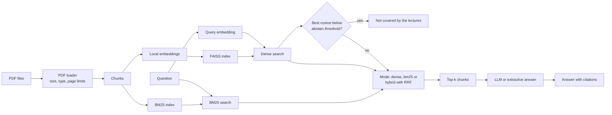

# Lecture RAG Assistant

A Retrieval-Augmented Generation (RAG) system for university lecture materials. Ask questions about your lecture PDFs and get answers with page-level source citations, or an explicit "not covered" when the material does not answer the question.


*The demo in its default dense mode answering "Which traversal would you use to order tasks with dependencies?" from the sample lectures, with page-level sources and cosine scores.*

## Why This Project?

As a Computer Science student at KIT Karlsruhe, I often need to search through large collections of lecture materials to find specific information. This tool demonstrates practical application of modern NLP techniques while solving a real student workflow problem.

Key features:
- **Fully local embeddings** using sentence-transformers (no API key needed for indexing)
- **Flexible LLM backend** supporting OpenAI, DeepSeek, Ollama, or any OpenAI-compatible API
- **Extractive fallback mode** for completely offline operation
- **Page-level citations** with file names and page numbers
- **Dense, BM25 and hybrid retrieval** combined with Reciprocal Rank Fusion
- **Abstention** when no indexed chunk is similar enough to the question
- **Evaluation harness** with committed results in `eval/results.md`

## Architecture



**Components:**
- **PDF Loader**: Extracts text with page-level metadata using PyMuPDF
- **Chunking**: Splits documents with overlap to preserve context
- **Embeddings**: Local sentence-transformers model (all-MiniLM-L6-v2, 384 dimensions)
- **Vector Index**: FAISS flat index with inner product similarity
- **BM25 Index**: Lexical index over the same chunks (rank-bm25 Okapi), built when first needed
- **Retrieval**: Dense, BM25 or hybrid (Reciprocal Rank Fusion of both). The query is embedded once per search
- **Abstention**: Declines to answer when the best dense cosine similarity is below the threshold
- **Generation**: Provider abstraction supporting LLM or extractive modes

### Retrieval Modes

- **dense**: FAISS cosine similarity search over sentence-transformer embeddings.
- **bm25**: Sparse lexical search using the rank-bm25 Okapi implementation.
- **hybrid**: Reciprocal Rank Fusion of dense and bm25 results. Each document's score is the sum of `1 / (60 + rank)` across both ranked lists, and the top `max(4k, 20)` candidates are taken from each retriever before fusion.

## Quick Start

### Installation

```bash
git clone https://github.com/arda6111/lecture-rag-assistant.git
cd lecture-rag-assistant
python -m venv venv
source venv/bin/activate  # On Windows: venv\Scripts\activate
pip install -e .
```

### Basic Usage

The sample PDFs in `data/sample_lectures/` are committed, so no setup step is needed. (`scripts/generate_sample_pdfs.py` only recreates them.)

1. **Index lecture PDFs**:

```bash
lecture-rag ingest data/sample_lectures
```

This creates a local index in the `index/` directory.

2. **Ask questions**:

```bash
lecture-rag ask "What is dynamic programming?" --mode extractive
```

3. **Run evaluation**:

```bash
lecture-rag eval
```

## Configuration

Copy `.env.example` to `.env` and configure it. The CLI and the demo load `.env` automatically. The API settings are only needed for LLM mode:

```bash
cp .env.example .env
```

Edit `.env`:

```env
OPENAI_API_KEY=sk-...
OPENAI_BASE_URL=https://api.openai.com/v1
OPENAI_MODEL=gpt-3.5-turbo
```

**Supported backends:**
- OpenAI (gpt-3.5-turbo, gpt-4)
- DeepSeek (base URL: https://api.deepseek.com/v1)
- Local Ollama (base URL: http://localhost:11434/v1)
- Any OpenAI-compatible API

LLM mode needs `OPENAI_API_KEY`, unless `OPENAI_BASE_URL` points at a local server on localhost or 127.0.0.1 such as Ollama. Without either, `--mode llm` stops with an error before making any request.

**Extractive mode works offline without any API configuration** (the embedding model is downloaded once on first use).

## CLI Usage

### Ingest Command

```bash
lecture-rag ingest <directory> [OPTIONS]
```

Options:
- `--index-dir PATH`: Output directory for index (default: `index`)
- `--model NAME`: Sentence-transformers model (default: `all-MiniLM-L6-v2`)
- `--chunk-size INT`: Max characters per chunk, at least 1 (default: 512)
- `--chunk-overlap INT`: Overlap between chunks, at least 0 and smaller than the chunk size (default: 64)
- `--max-file-size-mb FLOAT`: Maximum PDF file size in MB (default: `LECTURE_RAG_MAX_FILE_SIZE_MB` or `50`)
- `--max-pages INT`: Maximum number of PDF pages (default: `LECTURE_RAG_MAX_PAGES` or `500`)

`.pdf` files are matched case-insensitively. The command exits with an error if no PDF could be loaded.

### Ask Command

```bash
lecture-rag ask "your question" [OPTIONS]
```

Options:
- `--index-dir PATH`: Index directory (default: `index`)
- `--model NAME`: Embedding model, must match ingest model
- `--k INT`: Number of sources to retrieve, at least 1 (default: 5)
- `--mode {llm|extractive}`: Answer generation mode (default: `extractive`)
- `--retrieval {dense|bm25|hybrid}`: Retrieval mode (default: `LECTURE_RAG_RETRIEVAL_MODE` or `dense`)
- `--abstain-threshold FLOAT`: Minimum dense similarity required to answer, between 0 and 1 (default: `LECTURE_RAG_ABSTAIN_THRESHOLD` or `0.35`)

### Abstention

When the best dense cosine similarity between the question and any indexed chunk falls below the abstain threshold, the system declines to answer instead of producing an answer without support:

```bash
lecture-rag ask "What is the capital of France?"
# The lecture materials do not seem to cover this question.
```

The signal always uses dense similarity because BM25 and RRF scores are on different scales and are not comparable to a fixed cosine threshold. Source scores are printed with their kind, for example `cosine: 0.612`, `bm25: 3.210` or `rrf: 0.033`; an RRF score is a rank-fusion score, not a similarity.

### Eval Command

```bash
lecture-rag eval [OPTIONS]
```

Options:
- `--eval-file PATH`: Evaluation JSON file (default: `eval/eval_set.json`)
- `--index-dir PATH`: Index directory (default: `index`)
- `--model NAME`: Embedding model
- `--k INT`: Number of documents for metrics, at least 1 (default: 5)
- `--retrieval {dense|bm25|hybrid}`: Retrieval mode (default: `LECTURE_RAG_RETRIEVAL_MODE` or `dense`)
- `--compare`: Evaluate and compare dense, bm25, and hybrid retrieval
- `--sweep`: Sweep abstain thresholds from 0.20 to 0.60 in dense mode
- `--output DIR`: Evaluate all modes at k and at 1, run the sweep, and write `DIR/results.json` and `DIR/results.md`
- `--abstain-threshold FLOAT`: Minimum dense similarity required to answer, between 0 and 1 (default: `LECTURE_RAG_ABSTAIN_THRESHOLD` or `0.35`)

Set the `LECTURE_RAG_RETRIEVAL_MODE` environment variable to choose the default retrieval mode for `ask` and `eval`. The `--retrieval` option overrides the environment variable.

Set the `LECTURE_RAG_ABSTAIN_THRESHOLD` environment variable to choose the default abstain threshold for `ask` and `eval` (default: `0.35`). The `--abstain-threshold` option overrides the environment variable.

## Web Demo

Launch the interactive Streamlit demo:

```bash
pip install -e ".[demo]"
streamlit run demo.py
```

Navigate to http://localhost:8501 in your browser.

The sidebar controls the retrieval mode (dense, bm25, or hybrid), the abstain threshold, the number of sources to retrieve, and the answer mode (extractive or llm). It also lets you set the index directory; the `LECTURE_RAG_INDEX_DIR` environment variable sets its default value (falling back to `index`).

To regenerate the screenshot in this README:

```bash
streamlit run demo.py --server.headless true
```

Then, in a second terminal:

```bash
pip install -e ".[demo,screenshot]"
playwright install chromium
python scripts/capture_demo_screenshot.py
```

This writes `docs/demo.png`.

## Evaluation Results

The numbers below come from `eval/results.md` and `eval/results.json`, which are committed and produced by:

```bash
lecture-rag ingest data/sample_lectures
lecture-rag eval --output eval
```

**Eval set:** 33 questions in `eval/eval_set.json` (25 answerable spread over all 4 pages, many paraphrased; 8 unanswerable off-topic questions). Hit@k and MRR are computed over the 25 answerable questions; abstain accuracy over all 33. The index has 8 chunks.

**Retrieval mode comparison (abstain threshold 0.35)**

| Mode | Hit@5 | MRR@5 | Hit@1 | MRR@1 | Abstain acc |
|------|-------|-------|-------|-------|-------------|
| dense | 1.000 | 1.000 | 1.000 | 1.000 | 0.939 |
| bm25 | 1.000 | 0.980 | 0.960 | 0.960 | 0.939 |
| hybrid | 1.000 | 1.000 | 1.000 | 1.000 | 0.939 |

**Abstention at threshold 0.35 (dense)**

| Metric | Value |
|--------|-------|
| Abstain accuracy | 0.939 |
| Abstain precision | 0.800 |
| Abstain recall | 1.000 |
| Hit@5 after abstain | 0.920 |
| Mean cosine score (top 5) | 0.295 |

**Threshold sweep (dense)**

| Threshold | Abstain acc |
|-----------|-------------|
| 0.20 | 0.939 |
| 0.25 | 0.909 |
| 0.30 | 0.939 |
| 0.35 | 0.939 |
| 0.40 | 0.939 |
| 0.45 | 0.879 |
| 0.50 | 0.818 |
| 0.55 | 0.727 |
| 0.60 | 0.576 |

**What this shows, and what it does not:**
- All 8 off-topic questions are rejected at 0.35 (their best similarity is 0.11 to 0.29). 2 answerable paraphrased questions (strongly connected components, memoization vs bottom-up) score 0.23 and 0.26 and are wrongly rejected.
- 0.35 is the midpoint of the 0.30 to 0.40 plateau of the sweep.
- The sample corpus has only 4 pages, so dense and hybrid retrieval are saturated and BM25 misses one question at rank 1. These numbers are a sanity check, not a benchmark. A larger corpus is needed to compare the modes meaningfully.

## Testing

Run the test suite:

```bash
pip install -e ".[dev]"
pytest
```

`mypy src demo.py scripts` is run in CI.

The tests cover PDF loading and ingest limits, chunking, the FAISS and BM25 indexes, the three retrieval modes and RRF, abstention and eval metrics, answer generation, and the CLI (including an ingest and ask run on the sample PDFs and input validation errors).

The tests use a small deterministic hashing embedding model instead of sentence-transformers, so they run offline without API keys. They check behavior on the bundled sample data and do not measure retrieval quality on real lecture material.

## Project Structure

```
lecture-rag-assistant/
├── src/lecture_rag/       # Main package
│   ├── pdf_loader.py      # PDF extraction with metadata
│   ├── chunking.py        # Text splitting
│   ├── embeddings.py      # Local embedding model
│   ├── index.py           # FAISS vector index
│   ├── retrieval.py       # Search logic
│   ├── generation.py      # Answer generation (LLM + extractive)
│   ├── eval.py            # Evaluation harness
│   ├── models.py          # Pydantic data models
│   └── cli.py             # Command-line interface
├── tests/                 # Pytest test suite
├── data/sample_lectures/  # Sample PDFs
├── docs/                  # README screenshot (demo.png)
├── eval/                  # Evaluation questions and committed results
├── scripts/               # Utility scripts
├── SECURITY.md            # Security policy and vulnerability reporting
├── .github/
│   └── dependabot.yml     # Dependency update configuration
└── demo.py                # Streamlit web demo
```

## Limitations and Roadmap

**Current limitations:**
- No cross-page context (chunks are bounded by pages)
- No re-ranking step after retrieval
- Simple chunking (fixed size, no semantic splitting)
- Single index (no multi-collection support)
- The bundled eval set is small (33 questions over 4 pages), so it cannot separate the retrieval modes

**Done:**
- [x] Hybrid search (dense + BM25 with Reciprocal Rank Fusion)
- [x] Abstention for questions the lectures do not cover
- [x] Committed, reproducible eval results

**Planned improvements:**
- [ ] Add re-ranking with a cross-encoder
- [ ] Evaluate on a larger set of real lecture slides
- [ ] Support semantic chunking based on document structure
- [ ] Add conversation memory for follow-up questions
- [ ] Build a web API with FastAPI
- [ ] Add support for more document formats (PPTX, DOCX)

## Security

The ingest command only accepts real PDFs, verified by the `%PDF-` magic bytes. It rejects symlinks, encrypted PDFs (including PDFs with only an owner password), files over the size limit, and PDFs over the page limit.

The index stores chunk metadata as `documents.json` instead of pickle. Indexes built with older versions must be rebuilt with `lecture-rag ingest`.

CI runs `bandit` and `pip-audit`. Dependabot is enabled. See [SECURITY.md](SECURITY.md) for reporting vulnerabilities.

## License

MIT License. See [LICENSE](LICENSE) for details.

## Contributing

This is a portfolio project, but suggestions and feedback are welcome. Open an issue or submit a pull request.
